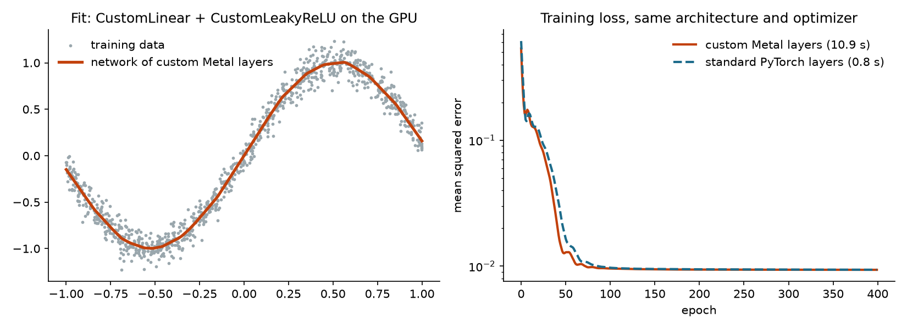
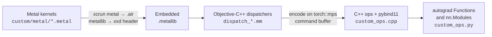

# Custom PyTorch ops in Metal


-lightgrey)


Write a GPU kernel in Metal, call it from PyTorch, and train a network with it. This repo walks the whole path for
Apple silicon: Metal shaders, a C++ / Objective-C++ PyTorch extension that dispatches them on PyTorch's own MPS
stream, and autograd-aware layers with explicit backward passes.



*A network made only of this repo's `CustomLinear` and `CustomLeakyReLU` layers, trained on the GPU, alongside the
same architecture in standard PyTorch. Both reach the same loss. The custom layers are slower (see
[What to expect](#what-to-expect)); the point is the integration. Made by `docs/make_figure.py`.*

## How it works



1. **Kernels.** Each op is a Metal compute kernel; one thread computes one output element.
2. **Build.** `setup.py` compiles every shader to AIR, links them into one `.metallib`, and embeds that library in a
   C header, so the extension carries its own kernels and needs no files at run time.
3. **Dispatch.** Objective-C++ dispatchers load the library, build a compute pipeline and encode the kernel on
   PyTorch's own MPS command buffer and dispatch queue (`torch::mps::get_command_buffer`), so custom ops interleave
   correctly with PyTorch's GPU work and tensors never leave the device.
4. **Bindings.** C++ ops check their inputs (device, contiguity, dtype), allocate outputs and are exposed with
   pybind11 through `torch.utils.cpp_extension`.
5. **Layers.** `torch.autograd.Function`s give each op an explicit backward pass, wrapped as `nn.Module`s.

## Ops

| Op | Kernel | Python | Backward |
|---|---|---|---|
| Matrix multiply | `matrix_multiply.metal` | `CustomLinear` | Input and weight gradients with the custom matmul |
| Matrix add (row broadcast) | `matrix_add.metal` | `CustomLinear` bias | Bias gradient |
| Vector add | `add_tensors.metal` | `add_tensors` | — |
| ReLU | `relu.metal` | `CustomReLU` | Yes |
| Leaky ReLU (slope 0.01) | `leaky_relu.metal` | `CustomLeakyReLU` | Yes |

Every op and every gradient is checked against PyTorch's own result in `tests/`, including a test that a network
of custom layers takes exactly the same training steps as the same network in standard PyTorch.

## Build and run

Needs an Apple silicon Mac with Xcode (for the Metal compiler) and PyTorch with MPS.

```bash
python -m venv .venv
.venv/bin/pip install -r requirements.txt
.venv/bin/python setup.py build_ext --inplace     # compiles the shaders and the extension
.venv/bin/python -m pytest tests                  # 8 tests against PyTorch
.venv/bin/python main.py                          # small demos and a timing comparison
.venv/bin/python docs/make_figure.py              # the training figure above
```

Use the layers like any PyTorch module:

```python
import torch.nn as nn
from custom import CustomLinear, CustomLeakyReLU

model = nn.Sequential(CustomLinear(1, 128), CustomLeakyReLU(), CustomLinear(128, 1)).to("mps")
```

## Project layout

```
custom/
  metal/                 Metal compute kernels
  dispatch_*.mm, *.h     Objective-C++ dispatchers on the MPS command stream
  utils.mm               loads the embedded .metallib, maps tensors to MTLBuffers
  custom_ops.cpp         C++ ops and pybind11 bindings
  custom_ops.py          autograd Functions and nn.Modules
tests/test_ops.py        ops, gradients and training checked against PyTorch
docs/make_figure.py      trains custom and standard networks, writes docs/training.png
notebooks/               training example and op benchmarks
main.py                  quick demos and timing
setup.py                 shader compilation and the extension build
```

## What to expect

These kernels are written to be read, not tuned: one thread per output element, no tiling and no threadgroup
memory. They match PyTorch's results, but the matrix multiply is about 100 times slower than PyTorch's own MPS
matmul on a 10,000 × 10,000 problem, and the custom network above trains about 13 times slower than the standard
one (M3 Max). Tiling the matmul in threadgroup memory is the natural next step.

## License

MIT
